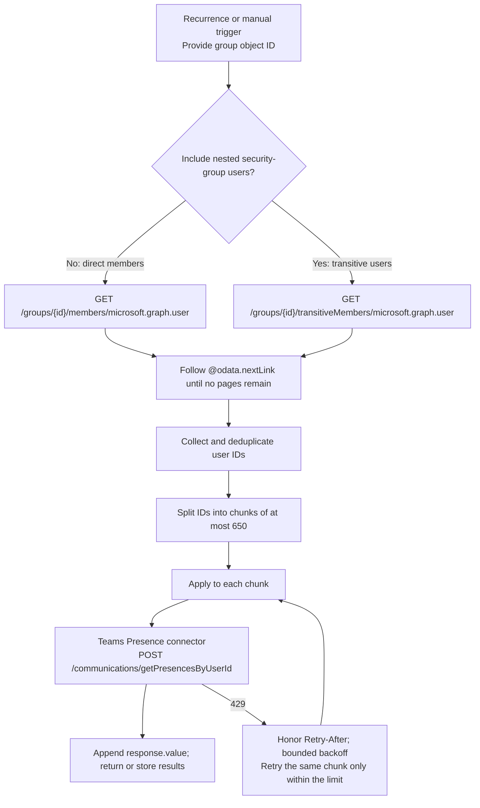

# Teams Presence custom connector

This repository contains an OpenAPI 2.0 definition for a Power Platform custom
connector that reads Microsoft Teams presence through Microsoft Graph.

## API

The connector exposes both single-user and batch lookups:

```text
GET  https://graph.microsoft.com/v1.0/communications/presences/{user-id}
POST https://graph.microsoft.com/v1.0/communications/getPresencesByUserId
```

`user-id` and each value in the batch `ids` array are Microsoft Entra object
IDs (GUIDs), not email addresses or display names. The batch operation accepts
up to 650 IDs per request. A successful presence result includes `id`,
`availability`, and `activity`, for example `Available` and `Available`.

## Requirements and authorized use

- A Microsoft Entra tenant with Microsoft Teams
- Permission to create or update a Power Platform custom connector
- The Microsoft Graph delegated permission `Presence.Read.All` with the
  required tenant consent

Use this connector only with authorization from your organization and for a
legitimate, disclosed purpose. Presence is personal information: limit access
to people and flows that need it, avoid collecting or retaining it longer than
necessary, and follow applicable privacy notices, organizational policies, and
law. The `Presence.Read.All` permission is retained because these operations
query arbitrary users; it is broader than a self-only permission.

## Register and configure the connector

1. In the [Microsoft Entra admin center](https://entra.microsoft.com/), go to
   **Identity > Applications > App registrations** and select **New
   registration**. Give the app a recognizable name. For an internal
   organization connector, choose **Accounts in this organizational directory
   only** unless your organization requires another supported account type.
2. Register the app. On its **Overview** page, record the **Application
   (client) ID** and **Directory (tenant) ID**.
3. Under **API permissions**, add **Microsoft Graph > Delegated permissions >
   Presence.Read.All**. This delegated permission is needed to query arbitrary
   users; have a tenant administrator grant consent.
4. In Power Automate or Power Apps, open **Data > Custom connectors** and
   select **New custom connector > Import an OpenAPI file**. Choose
   `Teams-Presence-API.swagger.json`.
5. In the connector's **Security** settings, select **OAuth 2.0** and
   **Azure Active Directory (Microsoft Entra ID)**. Enter the application
   (client) ID and the tenant/resource settings requested by the selected
   configuration. If the designer requires a client secret, create one under
   **Certificates & secrets**, copy it when created, and enter it in the
   connector configuration. Set an expiry and rotation plan; never commit the
   secret or access tokens to this repository.
6. Copy the redirect URL generated by Power Platform into the app
   registration's **Authentication** settings as a **Web** redirect URI.
   Confirm the delegated permission and required consent are in place.
7. Save the connector, create a connection, and test it with an authorized
   user's object ID.

The OpenAPI security definition names `Presence.Read.All` and includes
Microsoft identity platform v2 authorization and token endpoint examples. Do
not assume that importing this definition alone configures the correct
tenant-specific OAuth settings or that its scope entry is translated into a
particular Graph token request. Confirm the settings generated in the custom
connector designer and the permission/consent for the connection. Follow
[Microsoft's custom connector OAuth guidance](https://learn.microsoft.com/connectors/custom-connectors/connection-parameters)
and your tenant's app-registration requirements. Never commit client secrets
or tokens to this repository.

## Power Automate flow: group users to presence

The flow reads direct user members from a Microsoft 365 or security group. For
nested security groups, use the transitive-members endpoint shown below.



Group enumeration requires a separate Microsoft Graph connection/action with
delegated `GroupMember.Read.All`; the Teams Presence connector uses delegated
`Presence.Read.All` and does not enumerate groups. The editable source for this
diagram is
[`docs/power-automate-group-presence-flow.excalidraw`](docs/power-automate-group-presence-flow.excalidraw).

## Examples

Single-user lookup:

```http
GET /v1.0/communications/presences/aaaaaaaa-0000-1111-2222-bbbbbbbbbbbb
```

```json
{
  "id": "aaaaaaaa-0000-1111-2222-bbbbbbbbbbbb",
  "availability": "Available",
  "activity": "Available"
}
```

Batch lookup:

```http
POST /v1.0/communications/getPresencesByUserId
Content-Type: application/json
```

```json
{
  "ids": [
    "aaaaaaaa-0000-1111-2222-bbbbbbbbbbbb",
    "cccccccc-3333-4444-5555-dddddddddddd"
  ]
}
```

The successful batch response contains a `value` array of presence objects.

## Throttling and near-real-time alternatives

Avoid frequent polling and request only the users needed. Microsoft Graph can
return **429 Too Many Requests** with a `Retry-After` header (delay in seconds).
When implementing retries in a calling flow or application, honor that delay
and never retry earlier. Use bounded backoff when the header is absent—for
example, exponential delays with jitter capped at 30 seconds—and cap the retry
policy (for example, five total attempts or two minutes of elapsed retry time).
If `Retry-After` exceeds the remaining retry budget, stop and surface the
throttled response rather than retrying early. These are caller-side practices;
the OpenAPI definition does not implement retries.

For near-real-time updates instead of polling, Microsoft Graph presence change
notifications are an architectural alternative. They require a subscription
and a reachable notification endpoint, which this OpenAPI-only connector does
not provide. See [Get change notifications for presence updates](https://learn.microsoft.com/graph/changenotifications-for-presence).

## Microsoft Graph references

- [Get user presence](https://learn.microsoft.com/graph/api/presence-get?view=graph-rest-1.0)
- [Get presence for multiple users](https://learn.microsoft.com/graph/api/cloudcommunications-getpresencesbyuserid?view=graph-rest-1.0)
- [Presence resource type](https://learn.microsoft.com/graph/api/resources/presence?view=graph-rest-1.0)
- [Microsoft Graph permissions reference](https://learn.microsoft.com/graph/permissions-reference)
- [Authenticate a custom connector with Microsoft Entra ID](https://learn.microsoft.com/connectors/custom-connectors/azure-active-directory-authentication)

## Troubleshooting

- **400 Bad Request:** verify each supplied user ID is a GUID and that the
  batch contains no more than 650 IDs.
- **401 Unauthorized:** check the connection and OAuth configuration.
- **403 Forbidden:** confirm `Presence.Read.All` and the tenant-required consent.
- **404 Not Found:** verify the user object ID belongs to a user in the tenant.
- **429 Too Many Requests:** honor the `Retry-After` header and apply bounded
  caller-side backoff.

Microsoft Graph errors use an `error` object containing a `code` and `message`;
an `innerError` object may provide diagnostic details such as a request ID.
